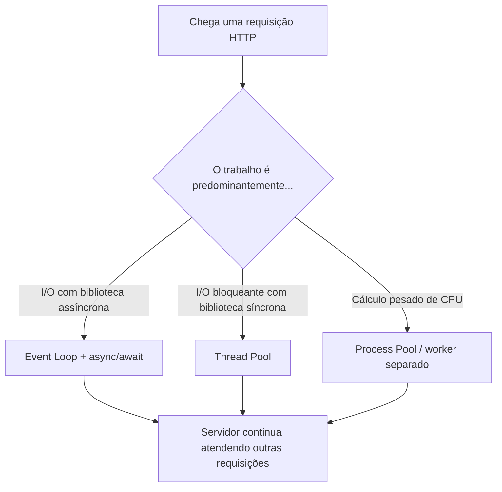
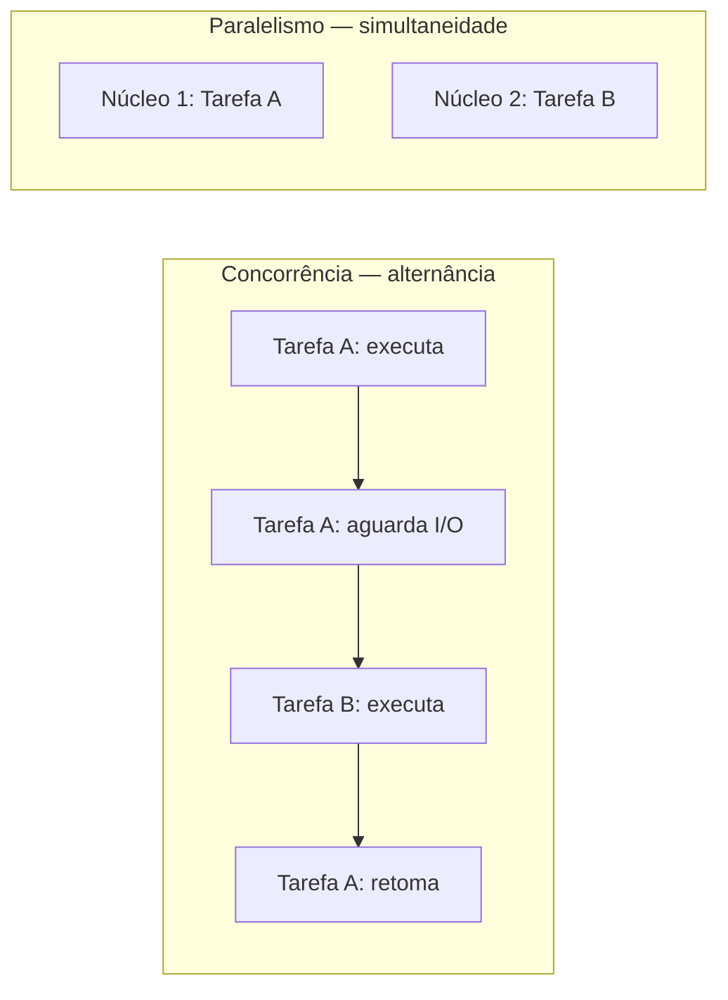
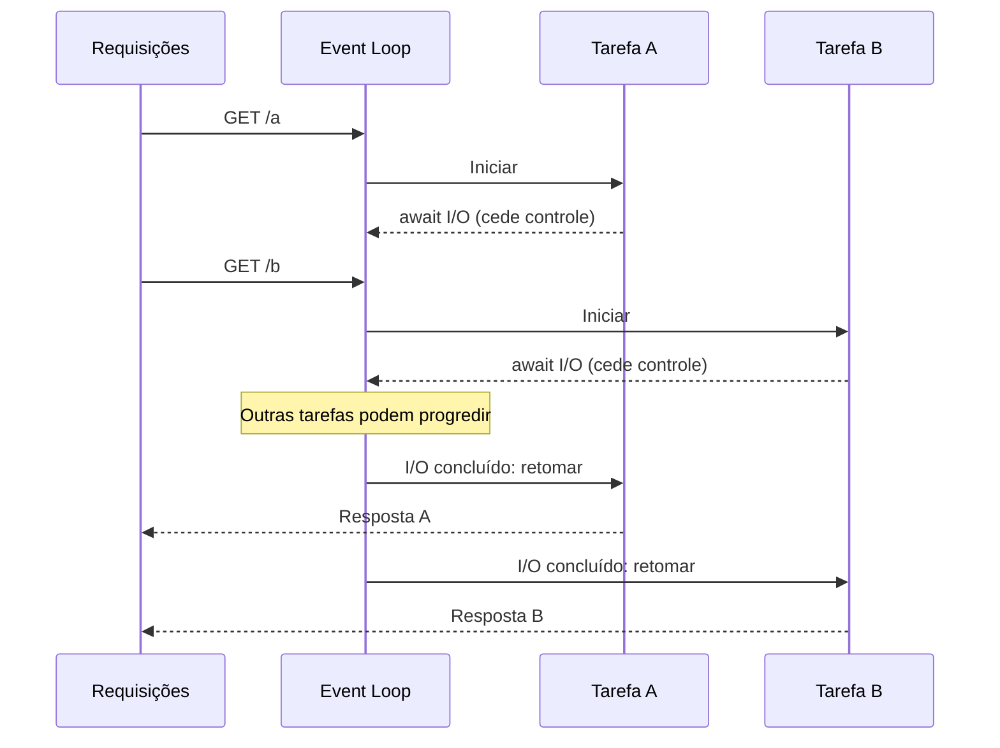
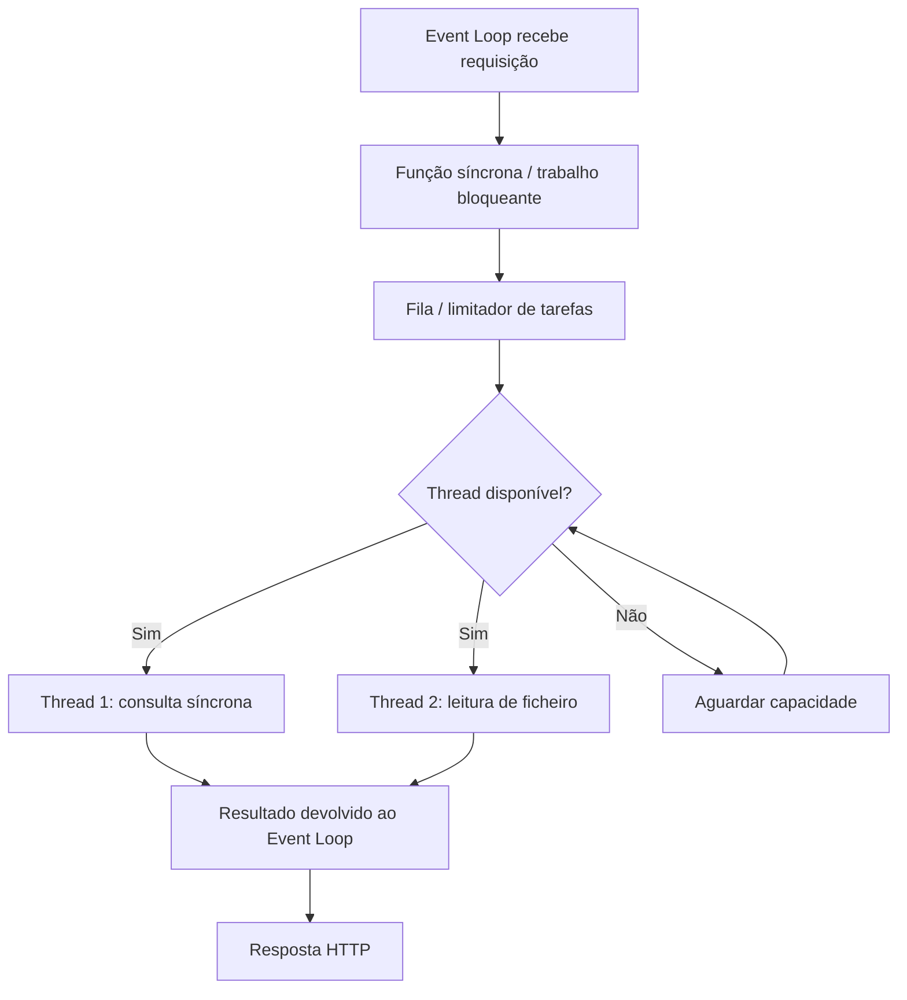
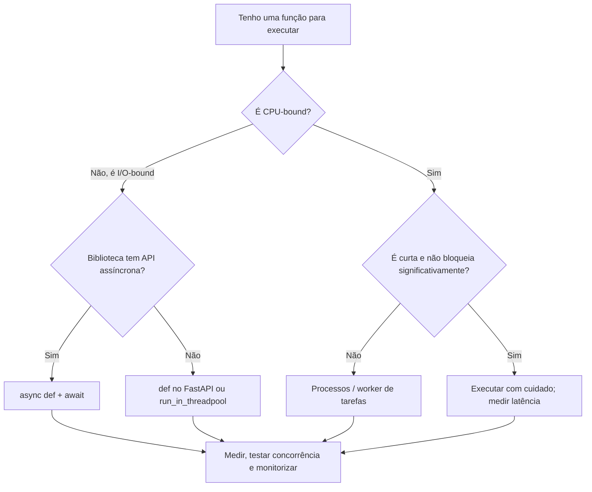

# Event Loop vs Thread Pool — Guia prático para Python e FastAPI

> **Projeto:** FinanceTracker
> **Contexto:** estudo de concorrência em Python, FastAPI e Uvicorn  
> **Objetivo:** compreender o funcionamento, os limites e os casos de uso de *Event Loop* (laço de eventos) e *Thread Pool* (conjunto de threads).

## 1. Visão geral

Ambos permitem que um servidor atenda várias tarefas sem precisar esperar que cada uma termine antes de iniciar a próxima. **Não são, porém, a mesma técnica.**

- **Event Loop:** coordena tarefas assíncronas, normalmente em uma thread, alternando entre elas quando chegam a pontos de espera que cedem o controle (`await`).
- **Thread Pool:** mantém um conjunto de threads de trabalho que podem executar funções síncronas; enquanto uma thread aguarda uma operação bloqueante, outras podem progredir.
- **Process Pool:** executa trabalho em processos separados, útil em certos casos de processamento intensivo de CPU.



**I/O (*Input/Output*)** inclui consultas à base de dados, chamadas HTTP, acesso a ficheiros e esperas de rede. O importante é saber se a API utilizada é **assíncrona** ou **bloqueante**.

## 2. Concorrência não é o mesmo que paralelismo

- **Concorrência (*Concurrency*):** várias tarefas avançam em períodos sobrepostos, mesmo que apenas uma execute código Python em determinado instante.
- **Paralelismo (*Parallelism*):** várias tarefas efetivamente executam ao mesmo tempo, por exemplo em diferentes núcleos de CPU.



Um *Event Loop* pode proporcionar concorrência eficiente sem executar simultaneamente dois trechos de Python na mesma thread. Threads podem ser escalonadas em paralelo, mas, no CPython tradicional com GIL (*Global Interpreter Lock*), código Python puro e intensivo de CPU geralmente não ganha paralelismo efetivo com threads. Há exceções, como bibliotecas nativas que libertam o GIL e builds de Python sem GIL.

## 3. Como funciona o Event Loop

O *Event Loop* agenda tarefas assíncronas (*coroutines/tasks*). Quando uma tarefa encontra um `await` sobre uma operação realmente assíncrona e ainda pendente, **cede o controle**. O loop pode executar outra tarefa enquanto aguarda a conclusão do I/O.



### Exemplo adequado: espera assíncrona

```python
import asyncio
from fastapi import FastAPI

app = FastAPI()

@app.get('/async-wait')
async def async_wait():
    await asyncio.sleep(5)
    return {'message': 'Concluído'}
```

`asyncio.sleep(5)` simula uma espera **não bloqueante**. Durante esses cinco segundos, o loop pode avançar outras tarefas. Em aplicações reais, o benefício vem de chamadas assíncronas de rede ou base de dados, não de adicionar `async` a qualquer função.

### Exemplo inadequado: bloquear o Event Loop

```python
import time

@app.get('/bad-async')
async def bad_async():
    time.sleep(5)  # BLOQUEIA a thread do Event Loop
    return {'message': 'Concluído'}
```

`time.sleep(5)` bloqueia a **thread que executa o Event Loop**, e não apenas uma coroutine. Num único worker/event loop, outras tarefas dependentes desse loop ficam impedidas de avançar durante o bloqueio. **Não é correto afirmar que bloqueia todas as threads do servidor:** outros workers/processos, quando existentes, podem continuar a responder.

> Regra: `async def` não torna chamadas bloqueantes automaticamente assíncronas. Um `await` só ajuda quando a operação chamada realmente permite ceder o controle.

## 4. Como funciona o Thread Pool

Um *Thread Pool* tem threads disponíveis para executar funções síncronas. Uma requisição pode ser atribuída a uma dessas threads, deixando a thread do *Event Loop* livre para continuar a coordenar o servidor.



### Exemplo em FastAPI: endpoint `def`

```python
import time
from fastapi import FastAPI

app = FastAPI()

@app.get('/sync-wait')
def sync_wait():
    time.sleep(5)
    return {'message': 'Concluído'}
```

No FastAPI/Starlette, uma **função de endpoint declarada com `def`** é normalmente executada em um *Thread Pool*, para não bloquear diretamente o *Event Loop*. Enquanto uma thread dorme, outras requisições podem ser atendidas, **até aos limites de capacidade** do pool e do servidor.

**Atenção:** uma função auxiliar síncrona chamada diretamente de dentro de `async def` **não é enviada automaticamente** ao pool:

```python
import time

def helper_bloqueante():
    time.sleep(5)

@app.get('/still-bad')
async def still_bad():
    helper_bloqueante()  # chamada direta: bloqueia o loop
    return {'ok': True}
```

Quando for necessário adaptar código síncrono dentro de um endpoint assíncrono, uma opção é descarregá-lo explicitamente para uma thread:

```python
from starlette.concurrency import run_in_threadpool

@app.get('/adapted')
async def adapted():
    await run_in_threadpool(helper_bloqueante)
    return {'ok': True}
```

Isto **não transforma a função em assíncrona**: ela continua a ocupar uma thread enquanto executa.

## 5. Comparação lado a lado

| Critério | Event Loop | Thread Pool |
|---|---|---|
| Modelo | Tarefas cooperativas com `async`/`await` | Threads de trabalho para funções síncronas |
| Melhor para | Muitas operações de I/O com APIs assíncronas | APIs bloqueantes/síncronas, integração com código legado |
| Durante espera de I/O | A coroutine cede o controle | A thread fica ocupada/à espera |
| Principal risco | Bloquear o loop com `time.sleep`, chamadas síncronas ou CPU pesada | Saturação do pool, overhead, condições de corrida |
| Escalabilidade | Boa para muitas conexões com esperas assíncronas | Limitada pela capacidade de threads e recursos |
| CPU intensiva em Python puro | Bloqueia o loop se executada nele | Geralmente não resolve o problema de paralelismo no CPython com GIL |
| FastAPI | `async def` | Endpoints `def` são normalmente descarregados para threads |

### Linha temporal conceptual

Os desenhos abaixo são **ilustrativos, não representam tempos medidos**.

```text
EVENT LOOP (uma thread; duas tarefas com I/O assíncrono)
Tempo ──────────────────────────────────────────────▶
Tarefa A: [executa][..... aguarda I/O .....][retoma]
Tarefa B:          [executa][... aguarda ...][retoma]
Loop:     [ A ]    [ B ]   [outras tarefas] [ A ][ B ]

THREAD POOL (duas threads; operações bloqueantes)
Tempo ──────────────────────────────────────────────▶
Thread 1: [Tarefa A: operação síncrona / espera.....]
Thread 2: [Tarefa B: operação síncrona / espera.....]
Loop:     [agenda A][agenda B][outras tarefas......]
```

## 6. Quando usar — e quando evitar

### Prefere Event Loop + `async def` quando

- A biblioteca disponibiliza métodos realmente assíncronos (por exemplo, `await client.get(...)`).
- Tens muitas chamadas de rede ou base de dados com tempo de espera.
- Precisas de lidar com muitas conexões concorrentes e consegues manter o caminho de execução não bloqueante.

**Evita** executar diretamente dentro do loop: `time.sleep`, `requests.get`, `psycopg` síncrono, leituras bloqueantes longas e cálculos pesados. `async def` por si só não acelera tarefas.

### Prefere Thread Pool / endpoint `def` quando

- Precisas de utilizar uma biblioteca que apenas oferece API síncrona/bloqueante.
- Queres reutilizar código síncrono sem bloquear o loop principal.
- O volume de operações bloqueantes cabe na capacidade do pool e da infraestrutura.

**Evita** tratar o pool como solução ilimitada: threads consomem memória, têm custo de agendamento e podem esgotar a capacidade disponível. Protege o acesso a estado partilhado quando necessário.

### Considera processos ou workers separados quando

- A operação é intensiva de CPU (*CPU-bound*): processamento de imagem, cálculo numérico pesado em Python puro, certas transformações de dados.
- O trabalho é demorado e não precisa terminar durante a requisição HTTP.

Possibilidades: `ProcessPoolExecutor`, tarefas em fila (*task queue*) ou serviços de processamento. Para operações de CPU que libertam o GIL, threads também podem ajudar, dependendo da biblioteca e da carga.



## 7. Exemplo aplicado ao FinanceTracker

O projeto utiliza **FastAPI + SQLAlchemy + Psycopg + PostgreSQL**. Há duas abordagens válidas; a escolha depende da forma como configurarmos a ligação à base de dados.

### Opção A — SQLAlchemy síncrono (mais simples para começar)

- `create_engine(...)` para um *Engine* síncrono.
- `Session(...)` síncrona.
- Funções de acesso à base de dados síncronas.
- Endpoints `def` quando o próprio endpoint faz chamadas bloqueantes.

```python
@app.get('/example-sync')
def example_sync():
    # Chamada síncrona à base de dados aqui
    return {'mode': 'sync'}
```

**Boa opção didática para o Dia 3:** permite compreender `Engine`, `Session`, modelos ORM e migrações antes de adicionar complexidade assíncrona.

### Opção B — SQLAlchemy assíncrono

- `create_async_engine(...)`.
- `AsyncSession`.
- Driver/URL compatível com operações assíncronas (por exemplo, `postgresql+psycopg://...` com o motor assíncrono do SQLAlchemy, conforme configuração suportada).
- Operações assíncronas aguardadas com `await`.

```python
@app.get('/example-async')
async def example_async():
    # await session.execute(...) usando AsyncSession
    return {'mode': 'async'}
```

**Não misturar:** usar uma `Session` síncrona diretamente dentro de `async def` pode bloquear o loop. Uma `AsyncSession` também não deve ser partilhada simultaneamente entre tarefas concorrentes; usa uma sessão adequada ao ciclo de vida de cada operação/requisição.

> **Recomendação para este estudo:** começar com SQLAlchemy síncrono e endpoints `def` para operações bloqueantes. Depois comparar com `AsyncSession` e endpoints `async def`, usando medições e exemplos concretos. Não é uma regra universal de arquitetura.

## 8. Experiência prática: testar a concorrência

Adiciona temporariamente ao `app/main.py`:

```python
import asyncio
import time
from fastapi import FastAPI

app = FastAPI()

@app.get('/demo/async-good')
async def async_good():
    await asyncio.sleep(3)
    return {'route': 'async-good'}

@app.get('/demo/async-bad')
async def async_bad():
    time.sleep(3)
    return {'route': 'async-bad'}

@app.get('/demo/sync')
def sync_route():
    time.sleep(3)
    return {'route': 'sync'}
```

> Se já tens `app = FastAPI()` no `main.py`, **não cries uma segunda instância**: adiciona apenas os imports necessários e as rotas.

Inicia o servidor na pasta `backend/`:

```bash
python -m uvicorn app.main:app --reload
```

Em **outro terminal**, com o servidor já ativo, executa duas requisições quase simultâneas:

```bash
# Testa a rota assíncrona adequada
(time curl -s http://127.0.0.1:8000/demo/async-good) &
(time curl -s http://127.0.0.1:8000/demo/async-good) &
wait
```

Repete substituindo `/demo/async-good` por `/demo/async-bad` e depois `/demo/sync`.

**O que observar (aproximações em ambiente sem carga, um worker):**

| Rota | Duas requisições | Motivo |
|---|---|---|
| `async-good` | Ambas tendem a concluir após ~3 s | `await` cede o controle |
| `async-bad` | Uma tende a concluir em ~3 s e a outra em ~6 s | `time.sleep` bloqueia o loop |
| `sync` | Ambas tendem a concluir após ~3 s | FastAPI pode executá-las em threads distintas |

Os resultados dependem do número de workers, limites do pool, sistema operativo e carga. O `--reload` é para desenvolvimento; não o utilizes como configuração de produção.

## 9. Erros comuns e correções

| Erro de interpretação | Correção |
|---|---|
| “`async def` é sempre mais rápido” | Depende da operação, biblioteca, carga e concorrência. |
| “`await` cria uma thread” | `await` normalmente suspende uma coroutine; não cria necessariamente threads. |
| “`time.sleep` bloqueia apenas uma coroutine” | Bloqueia a thread atual; no loop, prejudica outras coroutines. |
| “Todo `def` usa Thread Pool” | No FastAPI, endpoints síncronos são normalmente executados em threads; funções auxiliares chamadas diretamente não são automaticamente descarregadas. |
| “Thread Pool faz qualquer cálculo pesado ficar mais rápido” | CPU-bound em Python puro costuma ser limitado pelo GIL no CPython tradicional. |
| “`async def` com SQLAlchemy síncrono é assíncrono” | Chamadas síncronas continuam bloqueantes. |
| “Mais threads = desempenho ilimitado” | Existem limites de threads, memória, conexões e contenção. |

## 10. Perguntas de revisão

1. Qual a diferença entre concorrência e paralelismo?
2. O que acontece quando uma coroutine encontra `await asyncio.sleep(5)`?
3. Por que `time.sleep(5)` é perigoso dentro de `async def`?
4. Um endpoint `def` no FastAPI pode atender várias requisições ao mesmo tempo? Sob quais limites?
5. Para uma biblioteca de base de dados apenas síncrona, qual abordagem escolherias inicialmente?
6. Para um algoritmo pesado de processamento de imagem, por que um processo separado pode ser preferível?

### Respostas resumidas

1. Concorrência: progresso intercalado; paralelismo: execução simultânea.
2. A tarefa cede o controle e o loop pode avançar outras tarefas.
3. Bloqueia a thread do loop e atrasa outras tarefas naquele loop.
4. Sim, através do pool, até aos limites de capacidade e recursos.
5. Endpoint `def` ou descarregar explicitamente a chamada para thread.
6. Pode utilizar outro núcleo de CPU sem disputar o GIL do processo principal (no CPython tradicional).

## 11. Referências oficiais

- Python `asyncio`: https://docs.python.org/3/library/asyncio.html
- Python `asyncio.sleep`: https://docs.python.org/3/library/asyncio-task.html#asyncio.sleep
- Python `concurrent.futures`: https://docs.python.org/3/library/concurrent.futures.html
- FastAPI — funções de rota assíncronas e síncronas: https://fastapi.tiangolo.com/async/
- Starlette — Thread Pool: https://www.starlette.io/threadpool/
- SQLAlchemy — extensão asyncio: https://docs.sqlalchemy.org/en/20/orm/extensions/asyncio.html

---

**Síntese:** utiliza `async`/`await` para I/O realmente assíncrono, threads para adaptar operações síncronas bloqueantes e processos/workers para certas cargas pesadas de CPU. Escolhe com base no tipo de trabalho e mede o comportamento real.
